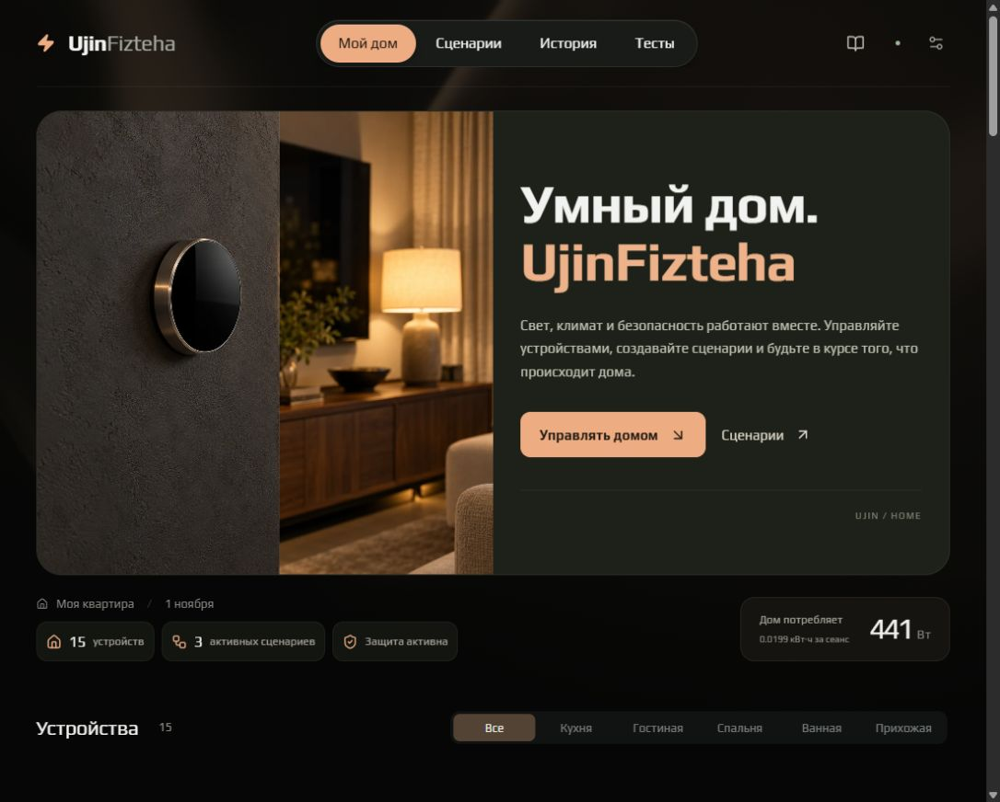
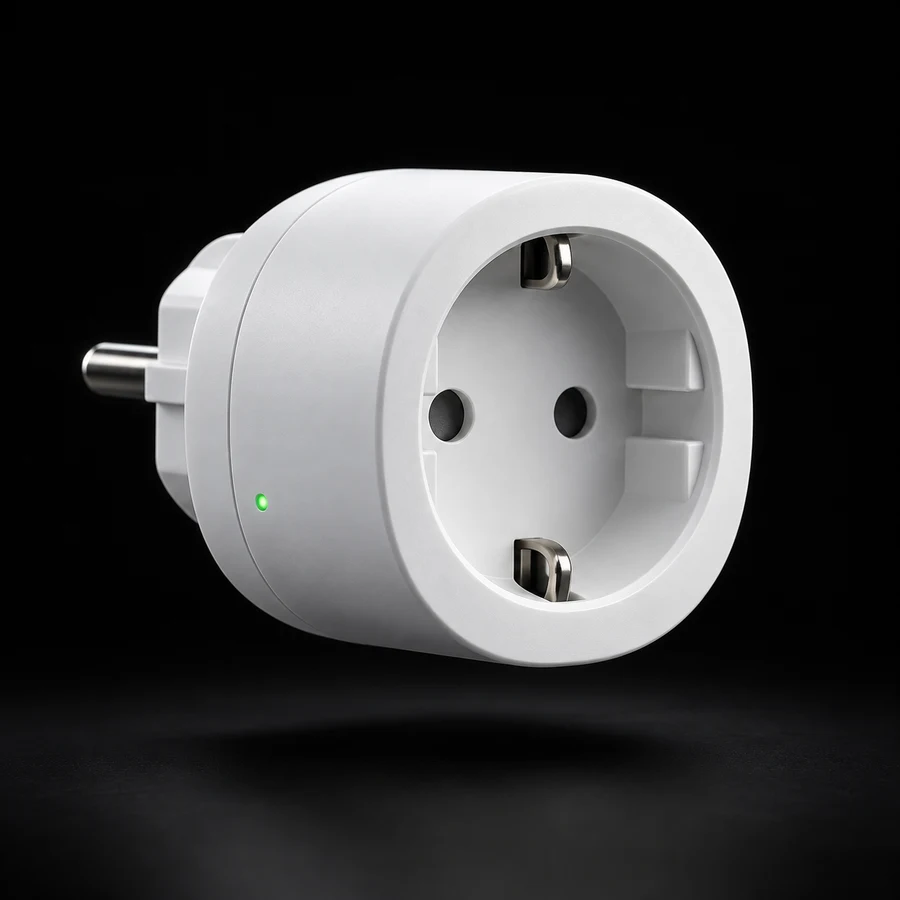
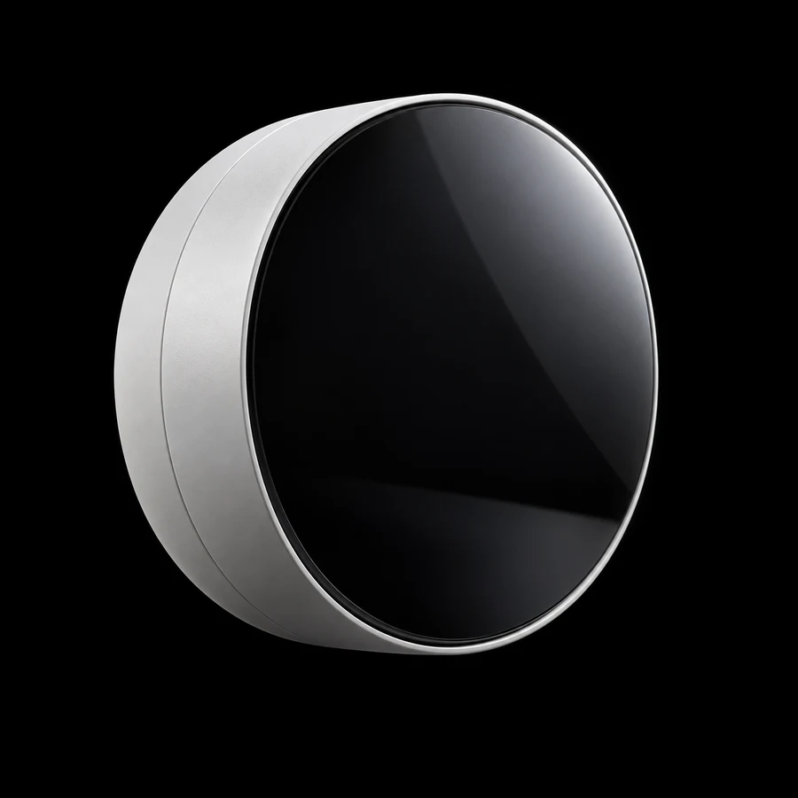
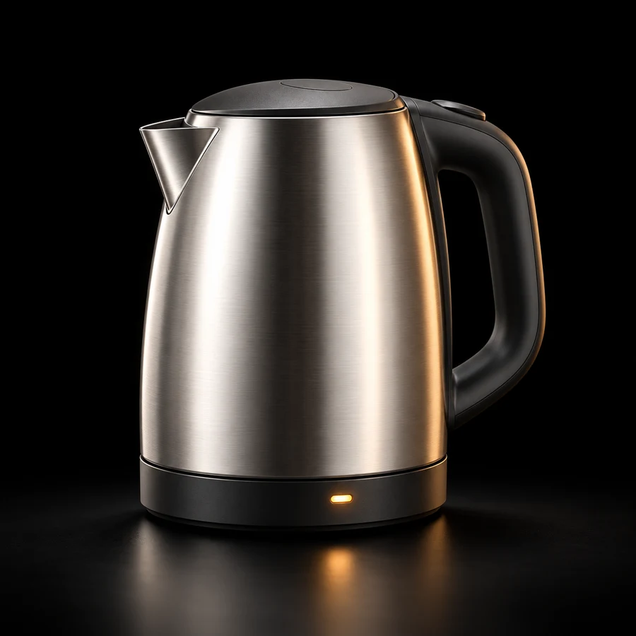

# UjinFizteha
Сылка на демо: http://46.147.47.179:8787/web
Ссылка на тг бота: https://t.me/@ujinsmarthouse_bot


Умный дом с веб-панелью, Telegram-ботом и MCP для AI-ассистентов.
Управляйте светом, климатом и бытовой техникой, создавайте сценарии и проверяйте
реакции устройств на аварии. Проект работает на эмуляторах устройств Ujin.



## Что умеет

- **15 устройств:** розетка, свет, климат, датчики, счётчик, бытовая техника и домофон.
- **Сценарии:** несколько действий, 8 готовых шаблонов и проверка перед сохранением.
- **Тесты:** диагностика устройств и 8 аварийных ситуаций с графиками и воспроизведением.
- **Уведомления:** включение, завершение работы, тревоги и восстановление на сайте и в Telegram.
- **Статистика:** мощность, энергия за сеанс и история показаний.
- **Интеграции:** REST API, MCP и адаптер обмена с Ujin.

Веб-панель, бот и MCP используют одно состояние дома. Аварийные тесты выполняются
на отдельном стенде и не изменяют устройства дома.

## Устройства

<table>
  <tr>
    <td align="center"><br>Умная розетка</td>
    <td align="center"><br>Свет</td>
    <td align="center"><br>Термостат</td>
    <td align="center"><br>Чайник</td>
  </tr>
</table>

## Запуск

Нужны **Node.js 22.12+** и **Python 3.11+**. В корне проекта, Windows PowerShell:

```powershell
npm ci
npm run build
python -m venv .venv-mcp
.\.venv-mcp\Scripts\python.exe -m pip install -r requirements-mcp.txt
.\.venv-mcp\Scripts\python.exe -m app.run --local
```

Откройте [веб-панель](http://127.0.0.1:8787/web/).
Экран входа демонстрационный. Нажмите «Посмотреть демо».

Для разработки интерфейса запустите `npm run dev` в отдельном терминале,
оставив Python-сервер работающим.

## Telegram и MCP

Для Telegram скопируйте `.env.example` в `.env`, заполните `TELEGRAM_BOT_TOKEN`
и `TELEGRAM_ALLOWED_CHAT_IDS`. Затем в отдельном терминале:

```powershell
.\.venv-mcp\Scripts\python.exe -m app.run --telegram --api-url http://127.0.0.1:8787
```

Для подключения AI-ассистента:

```powershell
.\.venv-mcp\Scripts\python.exe -m app.run --mcp-http --api-url http://127.0.0.1:8787
```

Адрес MCP: `http://127.0.0.1:8788/mcp`. 
Пример настроек:
[mcp.http.example.json](mcp.http.example.json).
Инструкция доступна и [на сайте](http://127.0.0.1:8787/web/#mcp).

## Подробнее

- [API и подключение MCP](docs/API.md)
- [Уведомления устройств](docs/NOTIFICATIONS.md)
- [Пример сопоставления сигналов Ujin](ujin-bindings.example.json)

Интерфейс: React, Vite. Сервер и эмуляторы: Python.
Для управления физическими устройствами требуется настройка интеграции Ujin;
её доступные возможности зависят от привязок и сигналов платформы.
