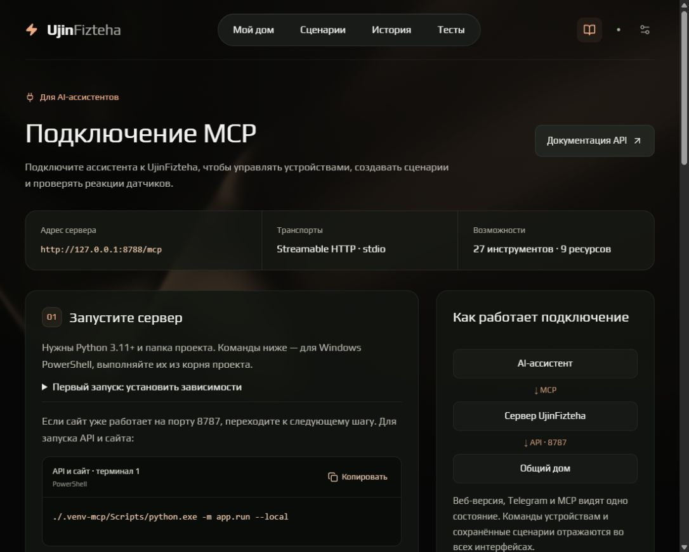
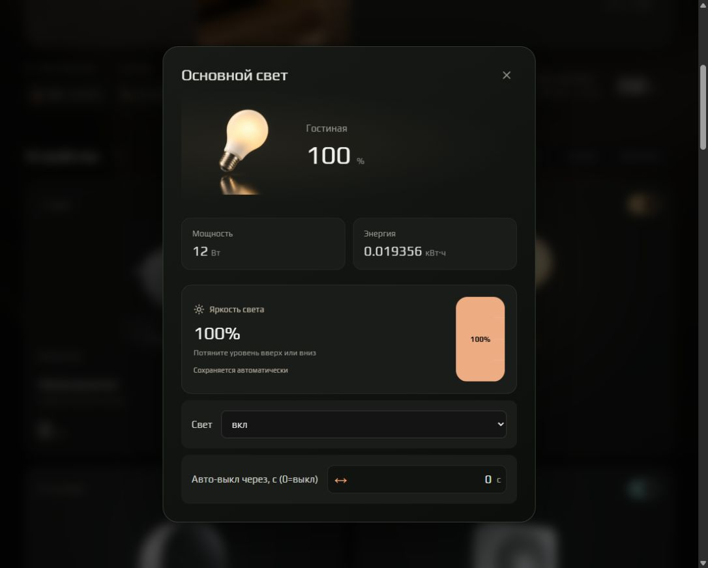
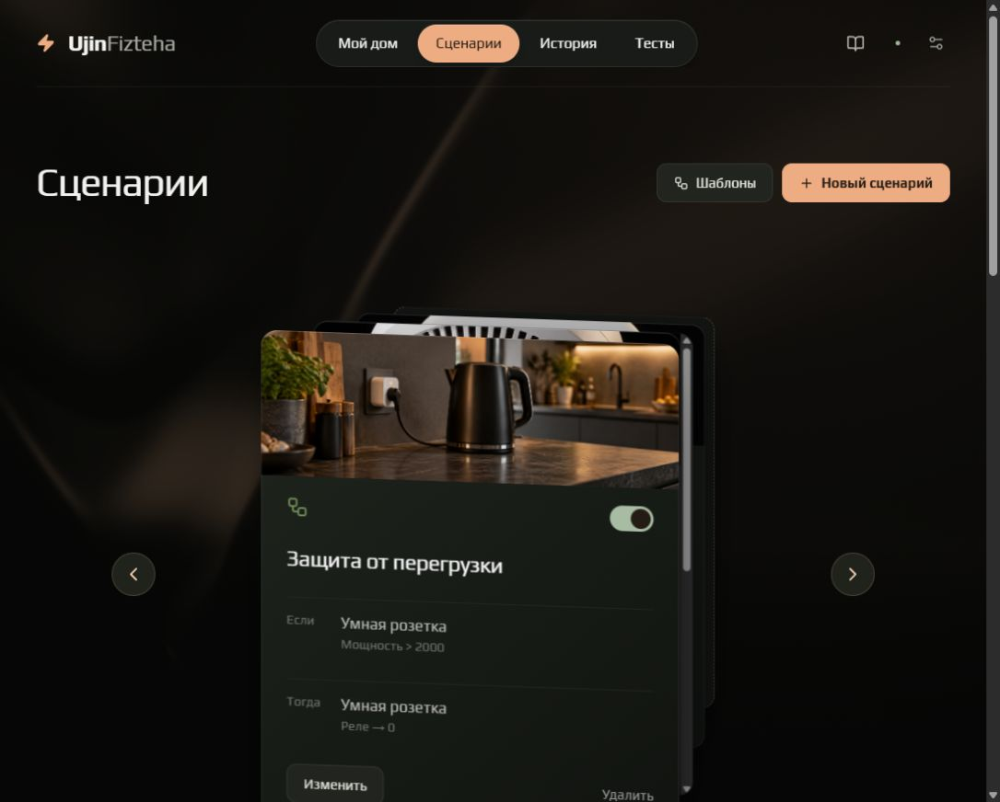
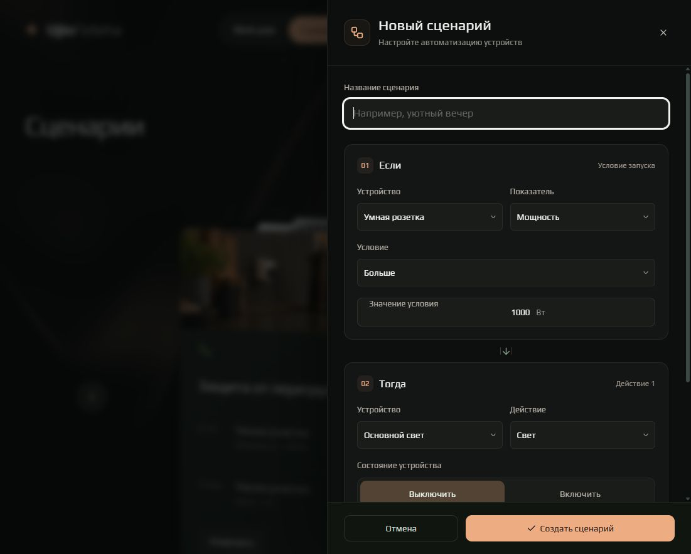
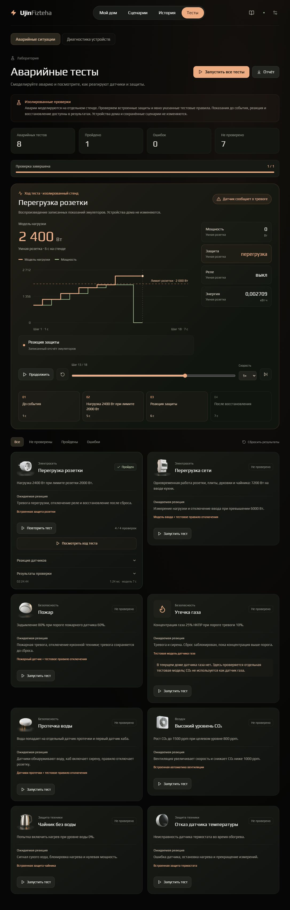
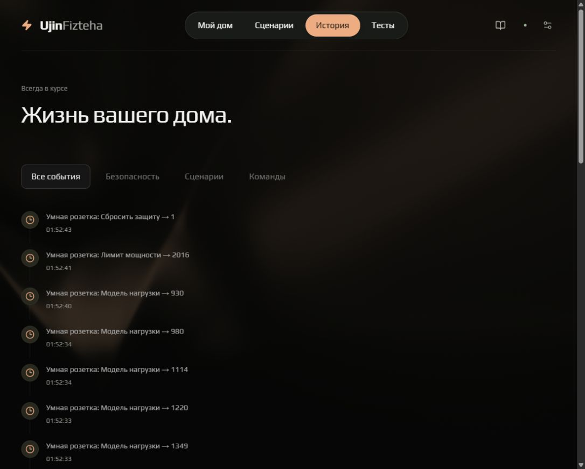
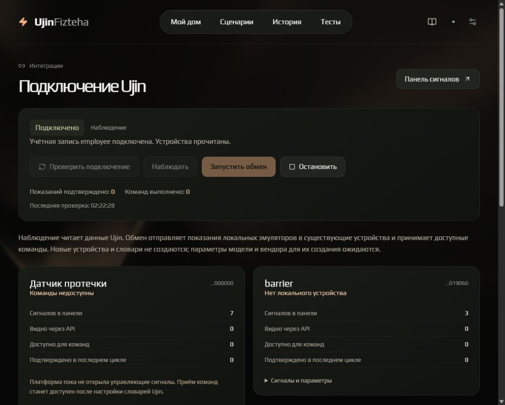

# UjinFizteha — аудит функций, ошибок и следующих этапов

Дата: 1 ноября 2026, Asia/Yekaterinburg.

Проверены исходники текущей рабочей копии, запущенный сайт, локальный REST API,
состояние интеграции Ujin и автоматические проверки. Снимки интерфейса сделаны
заново в ходе этого аудита, в открытом in-app браузере. Проверки ошибок выполнялись
на отдельных экземплярах Orchestrator и временном API, без изменения устройств
общего дома. Через интерфейс запускался только изолированный тест перегрузки.

## Вывод

Получился функциональный демонстрационный стенд умного дома: 15 устройств,
автоматизации, два вида тестирования, Telegram, REST и MCP используют общее ядро.
Сильные стороны — единое состояние, автоматическое сохранение настроек устройств,
визуализация реальных отсчётов тестового стенда и общий каталог шаблонов.

Готовность к длительной эксплуатации ограничивают модель электросети, неполный
журнал аварий, сохранение состояния только в памяти и частичный обмен с Ujin.
Следующий этап имеет смысл посвятить достоверности поведения и данных.

## Карта функций

| Функция | Состояние | Что подтверждено / чего не хватает |
| --- | --- | --- |
| Единый backend для веба, Telegram и MCP | Реализовано | HttpHomeClient и LocalHomeClient, общий Orchestrator; транспорт HTTP проверяется тестами |
| 15 домашних устройств | Реализовано | Розетка, свет, термостат, вентиляция, температура/влажность, протечка, хаб, пожар, счётчик, ТВ, холодильник, чайник, плита, духовка, домофон |
| Карточки, фотографии и фильтр комнат | Реализовано | Все 15 устройств отображаются; каталог самих устройств и комнаты пока заданы в коде |
| Настройки устройств без «Применить» | Реализовано | Автосохранение, объединение быстрых правок, очереди команд, обработка ошибки и откат |
| Slosh Gauge | Реализовано | Яркость и скорость вентиляции в подробных настройках; убран с обзорных карточек по запросу |
| Остановка измерений выключенного климата | Реализовано | Термостат и вентиляция замораживают показания; покрыто backend-тестом |
| Оформление React Bits / Play | Реализовано | Pill Nav, Card Swap, Magic Bento, анимации, фон, фотоблок главной страницы; фон в текущем App — DarkVeil |
| Статистика и график мощности | Частично | Текущие показатели и около 5 минут истории; нет достоверного общего электробаланса и длительного архива |
| Сценарии | Реализовано с ограничениями | Создание, редактирование, несколько действий, удаление, переключение, JSON-хранилище; одно условие сравнения |
| 8 шаблонов сценариев с фото | Реализовано | Безопасность, климат, комфорт; открывается редактируемый черновик; коллизии имён обработаны |
| Изолированный прогноз сценария | Реализовано | Проверка на 30 секунд из интерфейса; API допускает отдельную симуляцию |
| Диагностика всех устройств | Реализовано | 15 наборов проверок, одиночный/пакетный запуск, результаты, фильтры, экспорт |
| 8 аварийных тестов | Реализовано | Перегрузка розетки/сети, пожар, газ, вода, CO₂, сухой чайник, отказ термодатчика |
| Визуализация тестов | Реализовано | Рост нагрузки, пороги, измерения, отключение, восстановление, перемотка и скорость воспроизведения |
| Проверка именно пользовательских защитных сценариев | Не реализовано | Аварийный стенд очищает правила и устанавливает собственные; зелёный результат не доказывает защищённость настроенного дома |
| Газовый датчик на главной | Не реализовано | GasDetector существует только в отдельном аварийном тесте; это явно подписано в UI |
| Уведомления на сайте | Реализовано с ограничениями | Тревоги, ошибки, восстановление, действия сценариев; нет постоянного центра непрочитанных уведомлений |
| История событий | Частично | Фильтры и журнал есть, но только 200 событий в памяти; некоторые тревоги не попадают в видимый журнал |
| Telegram: устройства и сценарии | Реализовано | Динамические меню, все настройки, мастер правил, шаблоны, тесты, статистика, Ujin, подписки и фото |
| Свободный диалог в Telegram | Частично | Есть регулярные выражения для нескольких фраз; полноценного понимания произвольных запросов и составных инструкций нет |
| REST API | Реализовано для локального стенда | Документация, OpenAPI, CRUD сценариев, команды, статистика, тесты и Ujin; нет пользовательской авторизации и ролей |
| MCP stdio / Streamable HTTP | Реализовано | 27 инструментов, 9 ресурсов; инструкция на сайте, JSON-конфигурации; MCP сохраняет двухэтапные команды |
| Авторизация | Демонстрационный экран | Форма не проверяет учётные данные, вход запоминается через sessionStorage; это указано на самой форме |
| Интеграция Ujin | Частично | Employee подключается; 4 локальных семейства сопоставлены выделенным устройствам; двустороннее управление не подтверждено |
| Создание недостающих устройств в Ujin | Заблокировано внешней настройкой | Предыдущая попытка остановилась из-за отсутствия area_guid у квартиры 2746; appliances / other уже известны; в этом аудите создание повторно не запускалось |
| Экспорт сценариев в Ujin autoscripts | Не реализовано | Локальные правила не становятся автоматически облачными правилами Ujin |
| Расписания, AND/OR, задержки, гистерезис, приоритеты | Не реализовано | В модели правила только одно сравнение и список немедленных действий |
| Распознавание нагрузки, standby, стоимость, прогноз экономии | Не реализовано | analyze_energy возвращает сводку, а не распознавание профиля нагрузки или рекомендации из концепции |
| Управление инвентарём и комнатами | Не реализовано | Нет добавления/удаления устройств, переименования комнат, избранного и пользовательского порядка |
| Android Phone / TV APK | Отложено ранее пользователем | Есть браузерный TV-режим и управление стрелками, каталога android и инструкции сборки нет |
| Физические устройства | Не подключены | Текущий runtime — эмуляторы; нужен адаптер выбранного протокола/оборудования |
| Автозапуск, контейнер, CI | В репозитории не обнаружены | Нет Dockerfile, compose, .github/workflows; постоянный запуск пока не оформлен как поставка проекта |

## Подтверждённые проблемы

### P1. Электробаланс и энергия недостоверны

Источник: `app/orchestrator.py:151`, `app/home_client.py:276`,
`task/quattrocold/emulators/devices/counter.py:52`.

На новом экземпляре после 60 шагов сумма мощности приборов без счётчика равна
0 Вт, счётчик показывает 350 Вт, сводка дома — 350 Вт. Счётчик моделирует свою
кривую 200–500 Вт независимо от приборов и включён в сумму как потребитель.
Показание `total` за 60 шагов выросло на 38,8 кВт·ч. Даже 500 Вт за 60 секунд
дают около 0,00833 кВт·ч. Это демонстрационный дрейф, а не интеграл мощности.

Исправление: одна модель электробаланса; счётчик отражает сумму дочерних нагрузок,
не суммируется с ними повторно; энергия рассчитывается как P × dt / 3 600 000.
Отдельные фоновые нагрузки, если нужны, должны быть названы и учитываться явно.

Приёмка: нулевые нагрузки дают 0 Вт; 1000 Вт за час дают 1 кВт·ч; общий счётчик
согласован с приборами, тарифами и статистикой во всех трёх интерфейсах.

### P1. Модель вводного реле есть в тесте, но не в основном доме

Источник: `app/emergency_tests.py:44`, `app/orchestrator.py:116`, Counter.

В отдельном Orchestrator отправлены `counter_1.load_relay=0` и `light_1.lamp=1`.
После шага реле счётчика остаётся выключенным, а свет потребляет 12 Вт.
В аварийном тесте связь ввода с нагрузками моделируется отдельной логикой Stand.
Поэтому поведение успешного теста сети нельзя переносить на обычный runtime.

Исправление: описать электрические цепи, к какому вводу относится каждый прибор,
и применять отключение цепи в общем ядре, сохраняя логическое желаемое состояние.
Тест и рабочая модель должны использовать одну реализацию.

### P1. Пожарная тревога может отсутствовать в истории

Источник: `app/orchestrator.py:136`, `frontend/src/App.jsx:160`.

На чистом экземпляре вызваны `fire_1.set_smoke(80)` и `step()`.
Результат: `fire_1.alarm=1`, но список событий с типом, отличным от `log`, пуст.
Отдельные web/Telegram-наблюдатели могут уведомить по изменению сигнала, однако
журнал истории скрывает log. `_observe_state` формирует аварии только для розетки.

Исправление: единый генератор событий переходов для всех устройств на сервере.
Событие содержит устройство, тип тревоги, измерение, порог, источник, восстановление,
идентификатор инцидента и связанные реакции. UI и Telegram читают этот журнал.

### P1. Ошибка записи сценария не отменяет изменение в памяти

Источник: `app/orchestrator.py:216`, `:228`, `:241` и `_save`.

Временное хранилище намеренно сделано недоступным для замены файла.
`create_scenario` выдаёт OSError, но количество правил увеличивается с 1 до 2,
новое правило остаётся включённым. Клиент видит ошибку, а автоматизация уже активна.
Та же последовательность «изменить память → сохранить» используется при других
операциях с правилами.

Исправление: собрать следующее состояние отдельно, успешно сохранить его и только
после этого заменить рабочее состояние; при сбое возвращать прежние правила.
Запись файла уже делается через временный файл, но этого недостаточно для атомарности
операции целиком.

### P1. Противоположные сценарии не согласуются между собой

Источник: `app/orchestrator.py:255`.

Два включённых правила с истинным условием управляют `light_1.lamp`: первое
устанавливает 0, второе 1. Оба принимаются и выполняются; итог — 1, по порядку
обхода словаря. Предупреждения о конфликте и приоритета защитного действия нет.

Исправление: обнаруживать противоречия при сохранении, задавать приоритеты
«авария → ручная команда → комфорт», добавить задержку повторного срабатывания
и объяснять, почему команда была заблокирована/заменена.

### P2. Некорректное действие сценария возвращает 500 вместо 400

Источник: `app/orchestrator.py:200`, POST `/api/scenarios`.

Корректное имя и условие с `do: [null]` приводят к ответу 500:
`'NoneType' object has no attribute 'get'`. Нужна проверка типа каждого действия
до обращения к его полям, единая схема валидации и понятное сообщение о поле.

### P2. Результаты тестов теряются при навигации

Источник: `frontend/src/components/DeviceTestsPage.jsx:81`; подтверждено в браузере.

Тест розетки пройден, доступны отчёт и запись. После перехода в другой раздел
и возвращения в «Тесты» снова показано 0 пройденных, 8 непроверенных, отчёт недоступен.
Результат существует только в состоянии размонтируемого React-компонента.

Исправление: хранить отчёты на backend с id, датой и версией конфигурации;
в интерфейсе добавить историю запусков и восстановление последнего отчёта.

### P2. Архив и показатели не переживают перезапуск

Источник: `app/orchestrator.py:39`, `:124`, `:133`.

История обрезается до 300 отсчётов, события — до 200. Сохраняются правила,
а устройства, энергия, журнал и график создаются заново. Для демонстрации это
приемлемо и энергия подписана «за сеанс», но дневные/месячные отчёты так не построить.

Исправление: SQLite для событий, показаний, состояния и запусков тестов;
политика хранения, восстановление, резервная копия, экспорт CSV/JSON.

### P2. Интеграция Ujin показывает подключение учётной записи, не готовность управления

GET `/api/integrations/ujin` во время аудита: `state=connected`, `mode=read`,
`published=0`, `commands_applied=0`. У выделенных устройств доступно 0 управляющих
API-сигналов. У протечки `read_only`, у термостата, света и счётчика `no_signals`;
barrier не имеет локального соответствия.

Уточнить общий статус: «учётная запись подключена / чтение доступно / публикация
проверена / команды проверены». В `_load` сейчас перебираются только устройства
из исходного пакета, поэтому отдельный результат регистрации новых устройств
нужно будет подключить к каталогу привязок.

В UI устарело сообщение об ожидании модели/вендора: пользователь уже указал
`appliances` / `other`. Внешний блокер регистрации — area_guid квартиры, а не
неизвестность модели. Проверка не включала повторный запрос создания устройств.

### P2/P3. Есть расхождения документации и текущей реализации

`TODO.md`, `SESSION_CONTEXT.md`, `KILLER_FEATURES.md` содержат старые требования
к vanilla frontend, подтверждениям, 16 MCP-инструментам, трём разделам сайта и
старому Telegram. В верхних примечаниях часть исправлена, ниже остаются противоречия.
Нужен один актуальный список функций, отдельно история решений и отдельный backlog.

## Нереализованные идеи, которые дадут наибольшую пользу

| Приоритет | Функция | Польза и критерий готовности |
| --- | --- | --- |
| 1 | «Проверить защиту моего дома» | Клонировать текущие правила и настройки, подать аварийные воздействия и показать, какие нагрузки действительно отключатся; не добавлять защитные правила за пользователя |
| 2 | Объяснение инцидента | Карточка «что измерено → какое правило → какие команды → что получилось», с общей ссылкой из сайта, Telegram и отчёта |
| 3 | История запусков и сравнение | Сохранить baseline, сравнивать реакции до/после редактирования сценария; отмечать сломанную защиту |
| 4 | Условия AND/OR и расписания | «Если CO₂ > 1000 и дома есть люди», «выключить после 23:00»; часовой пояс, гистерезис и задержка повторения |
| 5 | Режимы «Дома / Ушёл / Ночь» | Единый набор согласованных действий вместо множества ручных переключений; безопасность имеет приоритет |
| 6 | Энергия и стоимость | После исправления физики: сутки/неделя/месяц, тариф, потребители, standby и рассчитанная экономия; не выдавать демонстрационный дрейф за аналитику |
| 7 | Диагностика связи с Ujin | Мастер привязки, наличие area_guid, класс/модель, сопоставление сигналов и тест чтения/записи; явные причины недоступности |
| 8 | Датчик газа в общем каталоге | Устройство в доме, настройки, фото, уведомления, сценарии, Telegram и MCP; газ и CO₂ остаются разными величинами |
| 9 | Настройка дома | Добавление устройств, имена/комнаты, поиск, избранное и компактный обзор; изменения сохраняются и видны в Telegram/MCP |
| 10 | Настоящие пользователи и роли | Владелец, член семьи, просмотр; право на команды/API/MCP/Telegram определяется сервером. Сейчас Telegram открыт всем по выбранной пользователем настройке — это не менялось в аудите |
| 11 | Развёртывание одним действием | Сервис Windows или контейнер, автоперезапуск, журналы, backup и health-check работы ядра; CI запускает текущие наборы тестов |
| 12 | Свободный диалог Telegram | Сначала однозначные команды/предпросмотр действий, затем понимание составных запросов; не называть текущий regex полноценным AI-диалогом |

Android APK и адаптер физического оборудования остаются отдельными ранее отложенными
этапами, а не обязательной частью ближайшего исправления веба.

## Визуальная проверка: шаги и снимки

Это проверка основных путей desktop-интерфейса; полная оценка WCAG, экранных
дикторов, производительности разных GPU и физических устройств не проводилась.
Мобильные сценарии и клавиатурная навигация дополнительно проходили в браузерных
автотестах. По снимкам нельзя подтвердить полноту доступности.

### 1. Документация MCP — работает

Подключение HTTP/stdio, копирование и конфигурация хорошо разделены. Доступ из шапки
только через значок книги слабее заметен новым пользователям; можно подписать «MCP».
Список инструментов статический — в будущем лучше формировать его из описания сервера.

### 2. Главная — работает, управление ниже первого экрана

Цветовая схема и фотографии единообразны. На проверенном экране около 1100×884
раздел устройств начинается на Y≈761: переключатели находятся ниже видимой области.
Фотоблок соответствует выбранному пользователем дизайну. Полезно добавить
необязательный компактный режим/избранное, сохранив этот вариант главной.

### 3. Настройки света — работает

Gauge, состояние света, таймер и показания размещены последовательно. Применение
автоматическое, лишней кнопки нет. Мелкие подписи и жест перетаскивания нужно
проверять при увеличении и с клавиатуры; наличие визуального регулятора само по себе
не доказывает доступность всех способов ввода.

### 4. Сценарии — работает, при росте списка нужен второй вид

Стрелки перелистывают карточки, слоган убран. Стопка скрывает остальные правила,
длинная карточка получает внутреннюю прокрутку. Для десятков правил стоит добавить
вид списком/таблицей, поиск и фильтр «включены / ошибки / безопасность».

### 5. Редактор — работает, поддерживает одно условие

Блоки «Если»/«Тогда», несколько действий и закреплённые кнопки заметны. При высоте
около 884 нижние действия требуют прокрутки. Добавить краткое словесное описание
правила и предупреждение о конфликте; расширение условий требует изменений backend.

### 6. Аварийный тест — работает, результат теряется после ухода

Перегрузка розетки: нагрузка растёт, затем показаны 2400 Вт модели нагрузки,
0 Вт фактической мощности, тревога и выключенное реле. Видно различие нагрузки
и измеренной мощности. Воспроизведение подписано как запись отдельного стенда.
После возвращения на страницу результат пропал — подтверждение проблемы выше.

### 7. История — частично

Крупные фильтры читаются, события упорядочены. Не хватает даты, поиска по устройству,
источника команды и связи с инцидентом; большое количество правок регулятора засоряет
ленту. Фильтр «Сценарии» сравнивает только `scenario_triggered`, поэтому сохранение,
удаление и переключение правил в него не попадают.

### 8. Ujin — частично, ограничения показаны

Экран честно показывает отсутствие команд и сопоставленных сигналов. Общая зелёная
надпись «Подключено» может восприниматься как готовность всей интеграции, хотя
подтверждён только вход/чтение. Нужны отдельные статусы для каждого этапа подключения.

## Проверки и границы доказательств

- `python -m unittest discover -s app/tests -v`: **112 прошли**.
- `python -m unittest discover -s task/quattrocold/emulators/tests`: **110 прошли**.
- `PLAYWRIGHT_CHANNEL=msedge npx playwright test --reporter=line`: **24 прошли**,
  примерно 1,9 минуты, отдельный backend на 8898.
- Дополнительно воспроизведены на отдельных экземплярах: независимая мощность счётчика,
  неверный прирост энергии, отсутствие связи вводного реле с прибором, невидимая в журнале
  пожарная тревога, противоречащие правила, изменение правил после ошибки записи,
  HTTP 500 на некорректном действии.
- При просмотре проверенного UI ошибок в console error/warn не получено.
- Тесты Telegram используют подставной Bot API: они подтверждают маршруты, фото и
  обработку ответов, но не заменяют новый ручной прогон переписки в Telegram.
- В Ujin проверялось состояние интеграции; записи сигналов, создания устройств и
  изменения словарей в рамках аудита не выполнялись.
- Прохождение 246 автоматических тестов не означает отсутствие ошибок: новые
  воспроизведённые случаи требуют отдельных регрессионных проверок после исправления.

## Предлагаемый порядок работ

1. Исправить электробаланс/энергию и согласовать модель вводного реле.
2. Сделать единый серверный журнал тревог и цепочку причин/действий.
3. Исправить атомарность сохранения, валидацию и конфликты сценариев.
4. Сохранить историю, состояние и отчёты в SQLite.
5. Добавить «Проверить мой дом» на текущих пользовательских правилах.
6. Закрыть блокеры Ujin и доказать полный цикл «команда → устройство → показание».
7. Добавлять расписания, режимы дома и расчёт экономии на надёжной базе.
